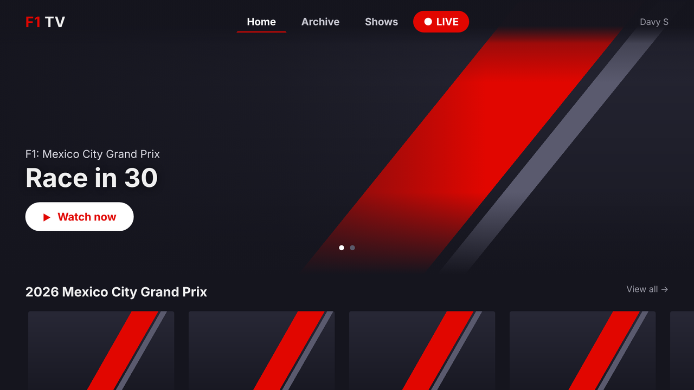

# F1 TV for LG webOS (unofficial)

An unofficial F1 TV client for LG TVs running webOS, which have no official F1 TV app. It is a plain webOS web app: sign in with a code on your phone, browse the F1 TV catalogue the way the official apps show it (home with a hero banner and content rows, Archive, Shows, race-weekend pages with a day-by-day schedule), pick a feed (main broadcast, pit lane, data channel, driver onboards) and watch with Widevine DRM through Shaka Player. A LIVE button appears whenever a session is live.

Not affiliated with Formula 1, F1 TV or Liberty Media. You need your own F1 TV subscription; use at your own risk. F1, FORMULA 1 and related marks are trademarks of Formula One Licensing BV.

Tested on an LG OLED55B9 (2019, webOS 4.5, Chromium 53). The code is written in ES5 on purpose so that it keeps working on those older TVs; it should work on anything newer as well.



## What you need

- An LG TV with webOS 4.5 or newer (2019 models and up) with **Developer Mode** enabled, see below.
- An F1 TV Pro subscription (F1 TV Access works for replays).
- A computer on the same network to copy the app to the TV.

## 1. Enable Developer Mode on the TV

1. Create a free LG developer account at <https://webostv.developer.lge.com/>.
2. On the TV, install the **Developer Mode** app from the LG Content Store and sign in with that account.
3. Turn **Dev Mode Status** on (the TV restarts) and then **Key Server** on. Note the IP address and the passphrase the app shows.
4. Developer Mode switches itself off after about 50 hours, which also removes the app. Press **Extend** in the Developer Mode app now and then, or let a script do it ([webOS Dev Manager](https://github.com/webosbrew/dev-manager-desktop) can).

## 2. Download or build the app

Download the latest `.ipk` from the [Releases](../../releases) page, or build it yourself:

```
git clone https://github.com/davyschroeder/f1tv-webos.git
cd f1tv-webos
python3 build_ipk.py src out        # or: ares-package ./src
```

`build_ipk.py` needs nothing but Python 3 and produces the same package layout as `ares-package`.

## 3. Install it on the TV

**With the webOS CLI** (Node.js required):

```
npm install -g @webos-tools/cli
ares-setup-device                   # add the TV: its IP, port 9922, user prisoner
ares-novacom -d myTV --getkey       # enter the passphrase from the Developer Mode app
ares-install -d myTV nl.davyschroeder.f1tv_0.2.0_all.ipk
ares-launch  -d myTV nl.davyschroeder.f1tv
```

**Without the CLI**, with plain `scp` and `ssh`. The TV's SSH key can be downloaded from `http://<tv-ip>:9991/webos_rsa` while Key Server is on:

```
scp -o HostKeyAlgorithms=+ssh-rsa -o PubkeyAcceptedAlgorithms=+ssh-rsa -i webos_rsa -P 9922 \
    nl.davyschroeder.f1tv_0.2.0_all.ipk prisoner@<tv-ip>:/media/developer/temp/
ssh -o HostKeyAlgorithms=+ssh-rsa -o PubkeyAcceptedAlgorithms=+ssh-rsa -i webos_rsa -p 9922 prisoner@<tv-ip> \
    "luna-send-pub -i -f 'luna://com.webos.appInstallService/dev/install' \
     '{\"id\":\"nl.davyschroeder.f1tv\",\"ipkUrl\":\"/media/developer/temp/nl.davyschroeder.f1tv_0.2.0_all.ipk\",\"subscribe\":true}'"
```

The second command keeps printing status until it says `"state": "installed"`; press Ctrl-C after that. The app then appears in the TV's app list as **F1 TV**.


## 4. Sign in

Start the app. It shows a short code and a QR code. On your phone or computer, go to the address shown (f1tv.com/pair), sign in with your F1 TV account and enter the code; the TV picks it up by itself. This is the same device-code flow the official TV apps use, so no password is ever typed on the TV.

If the pair page keeps asking you to sign in again, do it on a computer in a normal browser window (no private mode, ad blockers off): sign in on f1tv.formula1.com first, then open the full pair address shown under the code on the TV.

The session is stored on the TV and refreshed automatically. The playback token F1 hands out lasts a few days; after that the sign-in screen comes back.

## Controls

| Where      | Button          | Action |
|------------|-----------------|--------|
| everywhere | yellow          | debug log on/off (status of every API call, player errors) |
| sign-in    | OK              | new code |
| browsing   | arrows          | move between rows and cards; ◀ ▶ on the hero banner switches slide; ▲ from the first row reaches the tabs (Home, Archive, Shows, …) |
| browsing   | red             | jump to the live session (also the red LIVE tab) |
| player     | OK / play/pause | pause / play |
| player     | ◀ ▶             | 15 s back / forward |
| player     | green           | audio menu: International (English), Nederlands, Deutsch, …, natural sound; the choice is remembered |
| player     | red             | go to live |
| everywhere | BACK            | back; on the home screen it closes the app |

The Magic Remote pointer works too (point = focus, click = OK).

## How it works

- **Sign-in**: OAuth 2.0 device authorization grant on `id.formula1.com` with F1's public TV client id. The access token carries the `subscriptionToken` that the F1 TV API wants as the `ascendontoken` header.
- **Catalogue**: `f1tv.formula1.com/2.0/R/ENG/<provider>/ALL/MENU/PREMIUM/14` gives the tabs; every tab is a `PAGE/<id>` made of sections with a `layout` (`hero`, `horizontal_thumbnail`, `vertical_simple_poster`, `gp_banner`, `interactive_schedule`, …) that the app renders generically. Items are either a video (`contentId`) or a link to another page (`actions.onClick.uri`). Sessions (`VideoType = meetingSession`) open the feed picker first; `3.0/…/CONTENT/VIDEO/<id>/…` lists the feeds.
- **Playback**: `2.0/R/ENG/<provider>/ALL/CONTENT/PLAY?contentId=…` with the tokens as headers returns a DASH URL plus `laURL`, the Widevine licence server. The app tries the providers `BIG_SCREEN_DASH`, `WEB_DASH`, `BIG_SCREEN_HLS` and `WEB_HLS` until one returns a playable stream, and remembers the winner.
- **Player**: Shaka Player 4.3.6 (the last line that still runs on Chromium 53), loaded from cdnjs at start-up with jsDelivr as fallback. To bundle it instead, put `shaka-player.compiled.min.js` in `src/lib/` and change `CFG.shakaUrls` in `src/js/app.js`.

Manual fallback when the pair page will not cooperate: sign in on f1tv.formula1.com in a browser, copy the value of the `login-session` cookie (DevTools → Application → Cookies) and launch the app with it once:

```
ares-launch -d myTV nl.davyschroeder.f1tv --params '{"cookie":"<login-session value>"}'
ares-launch -d myTV nl.davyschroeder.f1tv --params '{"logout":true}'   # clears the stored session
```

## Releases

A version tag triggers the release workflow (`.github/workflows/release.yml`): it checks that the tag matches `src/appinfo.json`, builds the `.ipk` with `build_ipk.py`, takes the notes for that version from `CHANGELOG.md` and publishes a GitHub release with the package attached.

```
git tag v0.2.3 && git push origin v0.2.3
```

## Development

- `src/` is the app: `appinfo.json`, `index.html`, `css/app.css`, `js/app.js` (one file, ES5), `lib/qrcode.js`.
- `python3 test/smoke.py` runs the whole flow in headless Chrome against faked F1 endpoints (sign-in, home, weekend page, schedule, feeds, player, remote keys) and writes screenshots to `test/out/`. It needs Playwright for Python and a Chrome binary.
- The app icon is a generic placeholder; replace `src/icon.png` (80×80) and `src/largeIcon.png` (130×130) with your own before packaging.
- Display font: the logo, tabs and titles use [Orbitron](https://github.com/theleagueof/orbitron) (SIL Open Font License, `src/fonts/OFL-Orbitron.txt`), bundled as static regular and bold cuts because the TV's Chromium predates variable fonts. If you own a different display typeface, drop it at `src/fonts/f1-wide.ttf` and it takes precedence; that file is deliberately not part of this repo.
- Known gaps: the personal "Continue Watching" row is skipped (different auth), there is no 4K/HEVC selection yet, and switching feeds while watching is not implemented.

## Thanks

The API details come from these open-source projects: [F1AppleTV](https://github.com/NoahFetz/F1AppleTV), [RaceControl](https://github.com/robvdpol/RaceControl) and [F1-Web-Viewer](https://github.com/Tr4il/F1-Web-Viewer). QR codes by [qrcode-generator](https://github.com/kazuhikoarase/qrcode-generator) (MIT). Built with Claude.

## Licence

MIT, see [LICENSE](LICENSE). `src/lib/qrcode.js` keeps its own MIT licence header.
